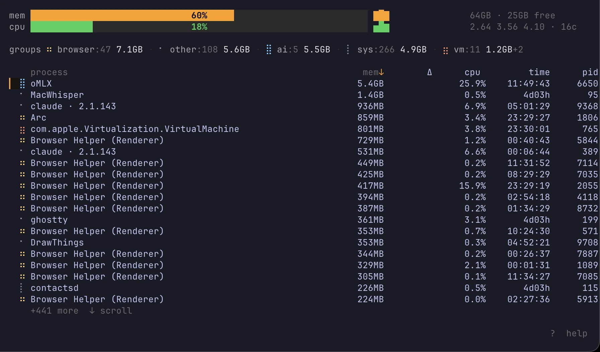

# memhog

memhog is a memory and process viewer for the terminal. It is made for people
who keep AI tools running all day: opencode, omp, dsh, claude-code, codex and
other coding agents, together with Ollama, editors, browsers and containers.

`htop` and `top` show every process as a separate line. That makes it hard to
see the real question: *which app is using my RAM?* memhog answers that. It
groups processes by app, shows how much memory each app uses in total, and lets
you stop the big ones with one key.



## Why use it

If you run opencode, omp, dsh, claude-code and codex next to an Ollama server,
two browsers and Docker on the same laptop, your memory problem has a shape. It
is not one bad process. It is an app that starts 30 helper processes.

memhog gives you three things that `htop` does not:

- **Grouping on two levels.** At the top, a single line shows the total memory
  of each category: AI · Agent, AI · LLM, Browser, Editor, VM, Runtime and
  others. The list below is grouped by app. For example, 32
  `Brave Browser Helper (Renderer)` processes become one row:
  `Brave Browser ×32 6.3GB`. Press `e` to open a group and see its processes,
  or `u` to switch back to one row per process.
- **Help with stuck agents.** If you use Claude Code, press `C` to remove idle
  Claude background workers. It keeps the main daemon and any worker that is
  still connected to a terminal. Press `X` to stop everything that belongs to
  Anthropic. It never stops the shell, terminal or Claude session that started
  memhog.
- **A memory guard.** Press `L` to turn on a watchdog. When free memory drops
  below your limit, memhog pauses the biggest safe process. Pausing is not the
  same as killing: the process can continue later. Change the limit with `+`
  and `-`.

memhog is written in Go and uses [Bubble Tea](https://github.com/charmbracelet/bubbletea)
and [gopsutil](https://github.com/shirou/gopsutil). It is one binary. It has no
daemon and no config file.

## Install

With Go:

```sh
go install github.com/elhenro/memhog@latest
```

From source:

```sh
git clone https://github.com/elhenro/memhog
cd memhog
go build -o ~/.local/bin/memhog .
```

Or download a binary from [Releases](https://github.com/elhenro/memhog/releases):
macOS (arm64 and amd64), Linux (arm64 and amd64) and Windows (amd64).

## Run

```sh
memhog
```

There are no flags to learn. Press `?` inside the app to see the key list.

## Keys

### Moving around

| key | what it does |
|---|---|
| `j` / `k` / `↑` / `↓` | move the cursor |
| `g` / `G` | go to the top / bottom |
| `ctrl-d` / `ctrl-u` | move half a page |
| `ctrl-f` / `ctrl-b` / `pgdn` / `pgup` | move one page |
| `/` | filter by name (case does not matter; `esc` cancels, paste works) |
| `c` / `0` | clear all filters |
| `1`–`9` | show only the Nth category (press again to clear) |
| `s` | change the sort order: `mem → cpu → Δ (growth) → category → name → time → pid` |
| `n` | show the raw process name instead of the friendly one |
| `e` / `enter` | open or close the selected app group |
| `u` | group by app, or show one row per process |
| `d` | show details for the selected row |
| `?` | show or hide the key help |

### Working with processes

| key | what it does |
|---|---|
| `space` / `p` | pause the selected row (a closed group pauses all its processes) |
| `r` | continue the selected row |
| `R` | continue every paused process |
| `t` | stop the selected row politely (SIGTERM, asks first) |
| `K` | kill the selected row (SIGKILL, asks first) |
| `C` | remove idle Claude background workers (asks first) |
| `X` | stop every Claude and Anthropic process (asks first) |
| `o` | jump to the first Ollama or oMLX process |

### Memory guard

| key | what it does |
|---|---|
| `L` | turn the guard on or off |
| `+` / `=` / `-` | change the free-memory limit in 512MB steps |

### Refresh speed and quit

| key | what it does |
|---|---|
| `<` | refresh slower (+500ms) |
| `>` | refresh faster (−500ms, minimum 500ms) |
| `q` / `ctrl-c` | quit |

## How processes are grouped

- **AI · Agent** — coding agents: opencode, omp, dsh, claude-code, codex, aider,
  goose and crush. They are found by their binary name, or by the package path
  when they run behind node or bun. Claude Code is found through its install
  paths (`@anthropic-ai/claude-code`, `~/.claude/local/`) and by the version
  number it uses as a process name (for example `2.1.143`). A process that only
  mentions an agent name in an argument stays where it belongs, so an editor
  with `~/.claude/settings.json` open is not renamed.
- **AI · LLM** — ollama, omlx, llama-server, LM Studio, llamafile, vLLM, mlx_lm.
- **Browser** — Chrome and its helpers, Safari, Firefox, Edge, Brave, Vivaldi,
  Arc, WebKit, Chromium.
- **Editor** — VS Code and its helpers, Cursor, Windsurf, Zed, Sublime, Neovim.
- **VM · Container** — Docker, OrbStack, QEMU, Podman, VMware, Parallels, Lima.
- **System** — kernel_task, launchd, WindowServer, loginwindow, syslogd, configd,
  powerd and similar. The guard never pauses these.
- **Runtime** — node, python, ruby, go, java, deno, bun.
- **Chat · Meet** — Slack, Discord, Telegram, WhatsApp, Signal, Zoom, Teams.
- **Other** — everything else.

The app name is the process name with common helper words removed. For example,
`Brave Browser Helper (GPU)` becomes `Brave Browser`. These rules are
guesses based on names, and they live in `proc.go`. Pull requests that improve
them are welcome.

## Safety

- **The nuke key (`X`) never stops memhog's own parent processes.** At startup
  memhog walks up its parent chain (up to 20 steps) and keeps those processes
  alive. Your shell and terminal survive.
- **Cleanup (`C`) keeps the Claude daemon** and any worker that still has a
  terminal attached. If memhog cannot check this (for example when `lsof` is
  missing), it keeps the worker instead of guessing. Workers that do not stop
  after a polite request are killed after one second.
- **The guard (`L`) never touches** `kernel_task`, `launchd`, `WindowServer`,
  `loginwindow`, `coreaudio`, `syslogd`, `configd`, `powerd`, ollama, omlx,
  coding agents, memhog itself, its parent chain, or a process that is already
  paused.
- **Stopping and killing ask first.** `t`, `K`, `C` and `X` show a confirmation
  dialog with the list of processes. Pause and continue (`space`, `r`, `R`) act
  immediately. All of them refuse to touch memhog itself, its parent chain, or
  critical system processes.

## Platform support

- **macOS** — the main target. Tested on Apple Silicon and Intel.
- **Linux** — works, but the name rules were written for macOS process names,
  so some processes may end up in "Other".
- **Windows** — builds and runs: list, sort, filter, terminate and kill work.
  Windows has no `SIGSTOP`, so pause, continue and the memory guard are turned
  off and the app tells you so.

## Planned

- per-process disk and file-handle details in the detail pane
- save sort, filter and guard settings to `~/.config/memhog/config.toml`
- export the current snapshot as CSV or JSON
- a tree view that shows parent and child processes

## License

MIT — see [LICENSE](LICENSE).
